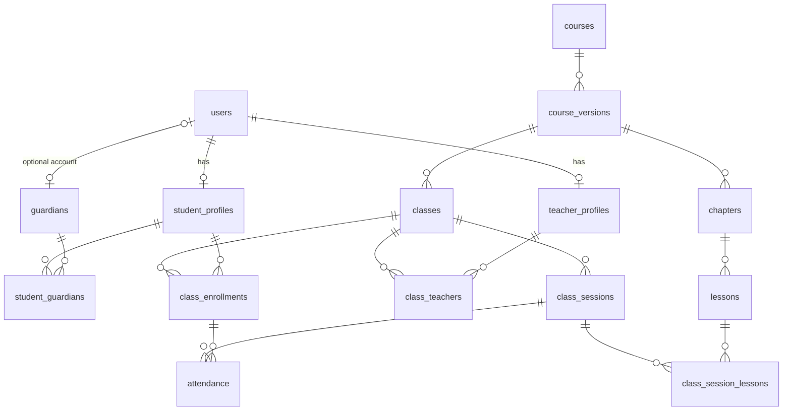

# Database schema

The source of truth is [`packages/database/prisma/schema.prisma`](../../packages/database/prisma/schema.prisma) and its migrations. This page explains how the tables fit together and why. Technical decisions and the rules the API must enforce are in the [architecture overview](README.md).

## Tables

| Area | Table | Purpose |
| --- | --- | --- |
| People | `users` | Every account: staff, students and guardians who log in |
| People | `user_roles` | System-wide roles of a user; a user can hold several |
| People | `auth_sessions` | Server-side login sessions; stores only the token hash |
| People | `student_profiles` | Student data, one per student user |
| People | `teacher_profiles` | Teacher data, one per teacher user |
| People | `guardians` | Parents and guardians; an account is optional |
| People | `student_guardians` | Links students and guardians; at most one primary contact per student |
| People | `audit_logs` | Who did what; a null actor means the system |
| Curriculum | `courses` | A course, independent of its content versions |
| Curriculum | `course_versions` | A numbered version of a course's content |
| Curriculum | `chapters` | Ordered chapters of a version |
| Curriculum | `lessons` | Ordered lessons of a chapter, each taught in `part_count` parts |
| Classes | `classes` | A class, tied to one course version |
| Classes | `class_teachers` | Teachers of a class and their role in it |
| Classes | `class_enrollments` | One row per student and class |
| Classes | `class_sessions` | Scheduled sessions of a class |
| Classes | `class_session_lessons` | Which lesson parts each session covers |
| Classes | `attendance` | One row per session and enrollment |

## Relationships

`users` also links to `user_roles`, `auth_sessions` and `audit_logs`. Those links, and the ones for `created_by` and `marked_by`, are left out to keep the diagram readable.



## Key designs

### Lessons taught across sessions

A session can cover several lessons, and a lesson can span several sessions. `lessons.part_count` sets how many parts the curriculum gives a lesson, and each `class_session_lessons` row records one part.

For a lesson A with two parts, where the second session also covers lesson B:

| Session | Lesson | `part_number` |
| --- | --- | --- |
| Session 1 | A | 1 |
| Session 2 | A | 2 |
| Session 2 | B | 1 |

The primary key includes `part_number`, so one long session can cover two parts of the same lesson.

### Enrollment status

Each student has at most one row per class, so restoring a student reuses the row and keeps their attendance.

| Status | Meaning | `left_at` |
| --- | --- | --- |
| `ACTIVE` | On the class list | Empty |
| `COMPLETED` | Finished the class | Empty |
| `DROPPED` | Really left; cannot rejoin this class | Required |
| `REMOVED` | Taken off the list, for example by mistake; can be restored | Required |

The database enforces the `left_at` column and the one-row rule. It does not enforce which status changes are allowed; the API must do that:

| Change | Allowed |
| --- | --- |
| `ACTIVE` to `COMPLETED`, `DROPPED` or `REMOVED` | Yes |
| `REMOVED` to `ACTIVE` | Yes; clear `left_at` |
| `DROPPED` to `ACTIVE` | Only as an admin correction, with a reason |

Which roles may perform each change is not decided yet.

### Attendance stays within one class

`attendance.class_id` is shared by two composite foreign keys, one to `class_sessions` and one to `class_enrollments`. A row that mixes a session and an enrollment from different classes is rejected by the database.

### People are not deleted

`users.status` deactivates an account. Foreign keys for profiles and for columns that record who acted (`created_by`, `marked_by`, `actor_id`) use `RESTRICT`, so deleting a user cannot erase who did what.

## Hand-written constraints

Prisma cannot express these, so they are written by hand at the end of each migration, under the `Hand-written` comment. Prisma ignores them when comparing schemas, so the CI drift check does not notice if one is missing.

| Table | Constraint | Rule |
| --- | --- | --- |
| `users` | `users_username_lowercase_check` | `username` is lowercase |
| `auth_sessions` | `auth_sessions_expires_after_created_check` | `expires_at` is after `created_at` |
| `student_guardians` | `student_guardians_one_primary_per_student_idx` | One primary contact per student (partial unique index) |
| `course_versions` | `course_versions_version_number_check` | `version_number` is above 0 |
| `course_versions` | `course_versions_published_at_check` | `PUBLISHED` requires `published_at` |
| `chapters` | `chapters_position_check` | `position` is 0 or more |
| `lessons` | `lessons_position_check` | `position` is 0 or more |
| `lessons` | `lessons_part_count_check` | `part_count` is above 0 |
| `classes` | `classes_capacity_check` | `capacity` is empty or above 0 |
| `classes` | `classes_date_range_check` | `end_date` is not before `start_date` |
| `class_enrollments` | `class_enrollments_left_at_status_check` | `left_at` is set only for `DROPPED` and `REMOVED`, and always for them |
| `class_enrollments` | `class_enrollments_left_after_enrolled_check` | `left_at` is not before `enrolled_at` |
| `class_sessions` | `class_sessions_time_range_check` | `ends_at` is after `starts_at` |
| `class_session_lessons` | `class_session_lessons_part_number_check` | `part_number` is above 0 |

To add one, create the migration without applying it, add the SQL, review it, then apply:

```sh
pnpm db:migrate:dev --name <change_name> --create-only
# edit the generated migration.sql
pnpm db:migrate:dev
pnpm db:generate
```

## Open decisions

The schema currently takes these defaults, all easy to change later:

| Question | Current default |
| --- | --- |
| Can a course have several `PUBLISHED` versions? | Yes, because running classes stay on older versions |
| Is a class limited to one main teacher? | No limit |
| Is the teacher recorded per session, for substitutes? | Not recorded |

**Blocks real use:** the schema has no parental consent record or data retention policy. Get this confirmed by someone with legal expertise before entering real student data.

## Planned tables

These are not built yet. They are proposals, and each area needs the approval shown before work starts.

| Area | Tables | Needs first |
| --- | --- | --- |
| Assignments and manual grading | `assignments`, `class_assignments`, `submissions`, `grades` | Nothing further |
| Files | `files`, `lesson_files`, `submission_files` | Approval for S3 |
| Tuition | `invoices`, `invoice_items`, `payments` | Confirmed tuition rules |
| Code grading | `coding_problems`, `test_cases`, `test_case_results` | Approval for a code runner |
| Notifications | `notifications` | A first feature that sends them |
